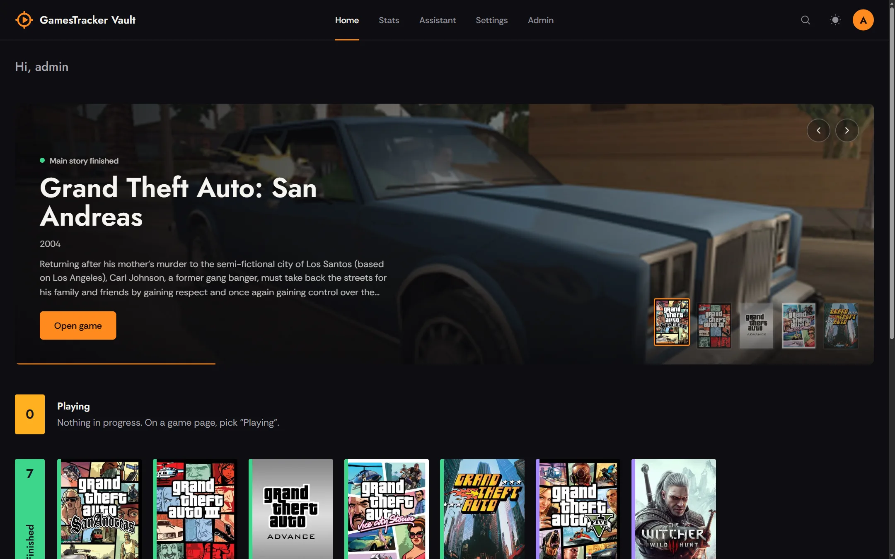
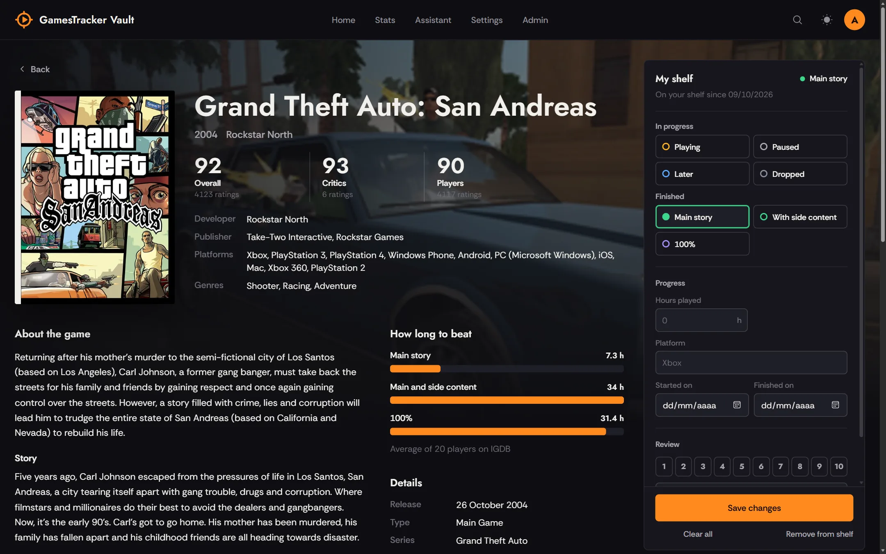
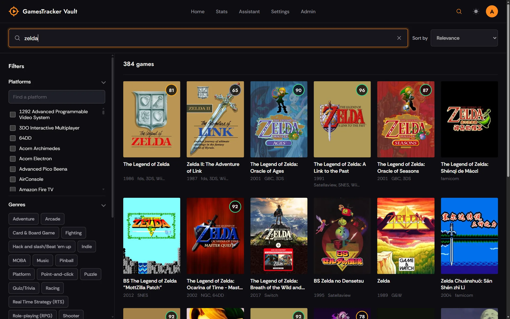
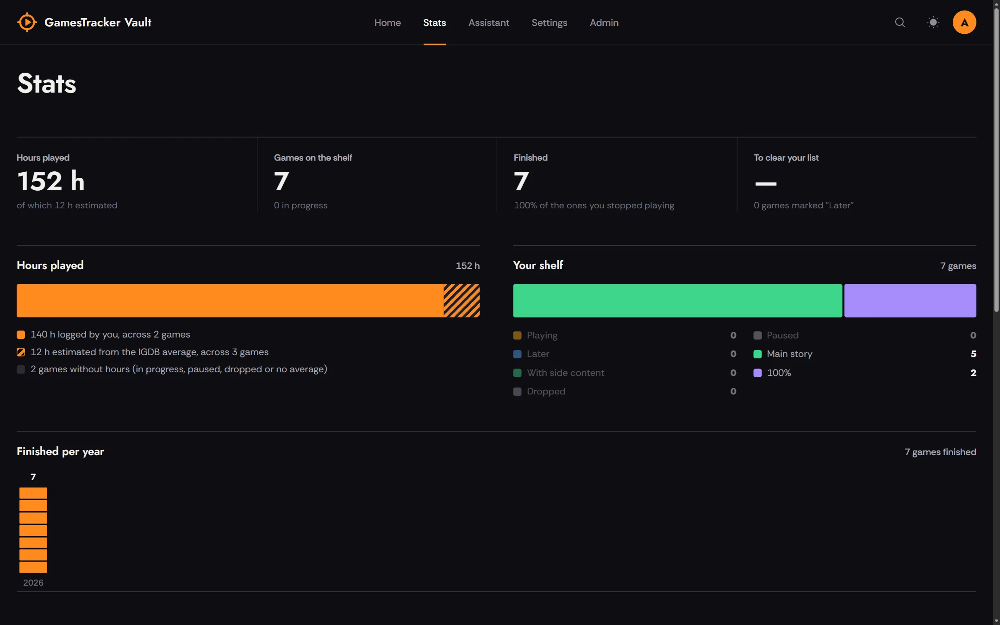
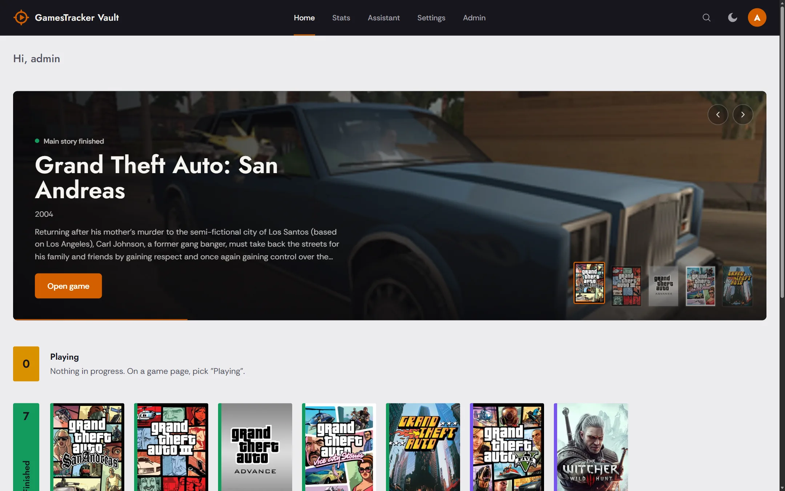
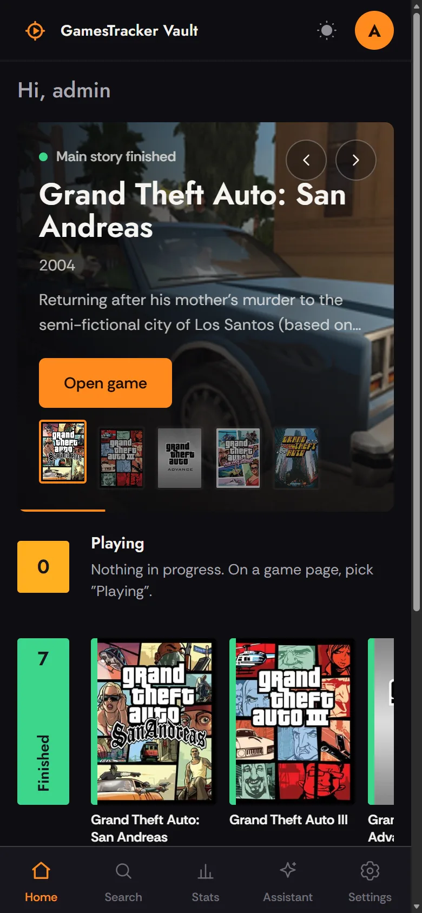
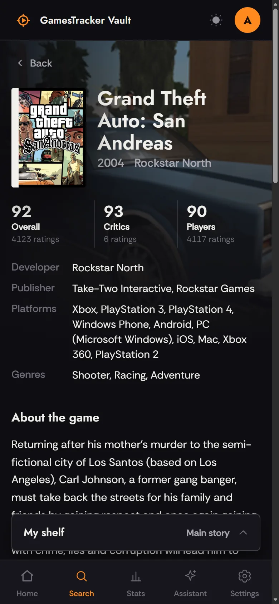
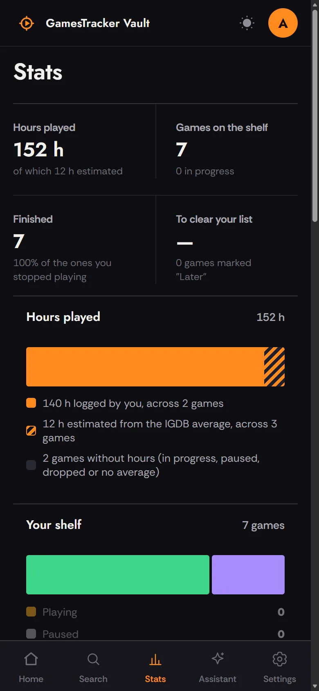
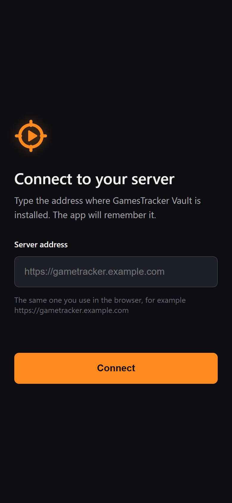

<div align="center">

# GamesTracker Vault

**Your game shelf, on your own server.**
What you're playing, what you finished, what you dropped and what's next — with hours,
dates, ratings, the platform you played on and stats, for everyone at home.

[](https://github.com/TTiagoSousa/GamesTracker-Vault/releases)
[](https://github.com/TTiagoSousa/GamesTracker-Vault/actions/workflows/ci.yml)
[](./LICENSE)
[](https://github.com/TTiagoSousa/GamesTracker-Vault/pkgs/container/gamestracker-vault)

*[Português](./README.pt-PT.md)*



</div>

## Features

- **Search the whole IGDB catalogue** with filters (platforms, genres, themes, modes,
  perspectives, years, minimum score) and a page for every game: artwork, summary,
  screenshots, videos and average time to beat.
- **A shelf per person**: playing, paused, to play, finished (main story or with extras),
  100% and dropped, with hours,
  start and end dates, rating, notes and the platform you played it on.
- **Home that shows your games**: a rotating spotlight on what you're playing, shelves
  you scroll with arrows, and a random pick when you can't decide.
- **Stats**: hours, games per status, genre, year and platform, and your ratings — using
  IGDB's average times where you didn't log hours.
- **Assistant** (optional): ask about games and get recommendations based on your shelf.
  Each person uses their own Anthropic key.
- **Android app** connected to your server, updating itself.
- **Several users**, created by the admin; English, Portuguese and Spanish; night and day
  themes; works on phones.
- **Backups** on a schedule you choose, to any folder, with download from the browser.
- **A REST API** with personal tokens (full or read-only): [docs/API.md](./docs/API.md).
- **Updates from the app** (Proxmox) or with `docker compose pull`.

## Screenshots

<table>
  <tr>
    <td width="50%"></td>
    <td width="50%"></td>
  </tr>
  <tr>
    <td align="center">Game page</td>
    <td align="center">Search</td>
  </tr>
  <tr>
    <td></td>
    <td></td>
  </tr>
  <tr>
    <td align="center">Stats</td>
    <td align="center">Day theme</td>
  </tr>
</table>

<table>
  <tr>
    <td width="25%"></td>
    <td width="25%"></td>
    <td width="25%"></td>
    <td width="25%"></td>
  </tr>
  <tr>
    <td align="center">Home</td>
    <td align="center">Game page</td>
    <td align="center">Stats</td>
    <td align="center">Android app</td>
  </tr>
</table>

## Quick start

### Docker

```bash
curl -fsSL https://raw.githubusercontent.com/TTiagoSousa/GamesTracker-Vault/main/deploy/docker/install.sh | bash
```

That creates `./gamestracker-vault` with the compose file and a `.env` with random
secrets, starts the app and its database, and prints the address and the admin login.
Prefer to do it by hand:

```bash
mkdir gamestracker-vault && cd gamestracker-vault
curl -fsSLO https://raw.githubusercontent.com/TTiagoSousa/GamesTracker-Vault/main/deploy/docker/docker-compose.yml
curl -fsSL https://raw.githubusercontent.com/TTiagoSousa/GamesTracker-Vault/main/deploy/docker/.env.example -o .env
nano .env                  # fill in the three secrets and the admin password
docker compose up -d       # then open http://<machine>:8080
```

Images for amd64 and arm64. Details: [docs/install-docker.md](./docs/install-docker.md).

### Proxmox VE

In the Proxmox host's shell:

```bash
bash -c "$(curl -fsSL https://raw.githubusercontent.com/TTiagoSousa/GamesTracker-Vault/main/deploy/proxmox/ct-create.sh)"
```

It creates a Debian 13 container with PostgreSQL, Node and nginx and installs the latest
release (login `admin` / `admin` — change it). Details, Debian without Proxmox and
maintenance: [docs/install-proxmox.md](./docs/install-proxmox.md).

Running a container from the old repository (`gametrackervault`)? Switch it with one
command: [docs/updating.md](./docs/updating.md#moving-from-the-old-repository).

### First steps

1. Sign in and change the password: **Settings → Account**.
2. Connect the game catalogue: create a free application in the
   [Twitch developer console](https://dev.twitch.tv/console/apps) (type *Confidential*;
   IGDB uses Twitch accounts) and enter its Client ID and Secret in
   **Admin → Game catalogue (IGDB)**.
3. Create accounts for the rest of the house in **Admin → Users**.
4. Optional: a domain with HTTPS ([docs/reverse-proxy.md](./docs/reverse-proxy.md)) and
   the assistant (each person adds an [Anthropic](https://console.anthropic.com/) key in
   **Settings → Assistant**).

The app's **Help** page walks through each step.

## Android app

Download the APK from your server (**Help → Android app**) or from the
[latest release](https://github.com/TTiagoSousa/GamesTracker-Vault/releases/latest),
install it and type your server's address. Android 8 or newer. HTTPS, self-signed
certificates and updates: [docs/android.md](./docs/android.md).

## Configuration, updates and backups

| | |
|---|---|
| Every setting | [docs/configuration.md](./docs/configuration.md) |
| Updating | Docker: `docker compose pull && docker compose up -d` · Proxmox: **Admin → Versions** or `gametracker-update` · [docs/updating.md](./docs/updating.md) |
| Backup and restore | **Admin → Backups**, and [docs/backup-restore.md](./docs/backup-restore.md) |
| Problems | [docs/troubleshooting.md](./docs/troubleshooting.md) |
| All the docs | [docs/](./docs/README.md) |

Keep a copy of `TOKEN_ENCRYPTION_KEY` (in `.env`, or `/root/gametracker-credentials.txt`
on Proxmox): it decrypts the keys stored in the database.

## FAQ

**Does it need the internet?** For searching and game details (IGDB) and the assistant,
yes. Your shelf, stats and everything you write stay in your database.

**What leaves my server?** Requests to IGDB (made by the server), cover images and videos
(loaded by the browser from IGDB and YouTube), assistant messages for people who set it
up (sent to Anthropic with their key, including their shelf), and — on Docker — a check of
the release list on GitHub. Nothing else, and no analytics.

**Does it cost anything?** No. The IGDB key is free. The assistant uses each person's
Anthropic account, billed by Anthropic.

**Can I import my games from another tracker?** Not yet — see the roadmap.

**Is there an iPhone app?** No, but the web app works in Safari and can be added to the
home screen.

**Can I run it without Docker or Proxmox?** Yes: the Proxmox installer also works on a
plain Debian 13 machine ([docs/install-proxmox.md](./docs/install-proxmox.md#without-proxmox-debian-13-vm-or-server)).

## Roadmap

Ideas being considered, not promises:

- import from CSV and other trackers;
- the Android app on F-Droid (the `fdroid` build already exists);
- lists and collections beyond the statuses;
- more charts in the stats (per month, per platform over time).

Suggestions are welcome in the [issues](https://github.com/TTiagoSousa/GamesTracker-Vault/issues).

## Development

```bash
npm install
cp apps/backend/.env.example apps/backend/.env   # fill it in
npm run dev                                      # http://localhost:5190
```

Node 22+ and PostgreSQL. Server in NestJS + Prisma, web app in React + Vite, Android app
in Java. Setup, commands, conventions and the release flow: [CONTRIBUTING.md](./CONTRIBUTING.md).

| Folder | What |
|---|---|
| `apps/backend` | server: NestJS + Prisma + PostgreSQL |
| `apps/frontend` | web app: React + Vite |
| `apps/android` | Android app (a WebView connected to your server) |
| `packages/shared` | types and constants used by both |
| `deploy/docker` | compose file, install script, image entrypoint |
| `deploy/proxmox` | LXC installer, updater and maintenance commands |
| `releases` | each release's notes (en, pt-PT, es), shown in the app |
| `docs` | guides, API reference and developer docs |

## Contributing and security

Contributions are welcome: read [CONTRIBUTING.md](./CONTRIBUTING.md) and the
[code of conduct](./CODE_OF_CONDUCT.md). Found a security problem? Please report it
privately as described in [SECURITY.md](./SECURITY.md).

## License

[GNU AGPL-3.0](./LICENSE). You can use, study, change and share it, including
commercially. If you run a modified version as a service for others, you have to offer
them its source code under the same license.

## Support

GamesTracker Vault is free and made in my spare time. If it's useful to you:

<a href="https://paypal.me/TTiagoSousa"></a>
