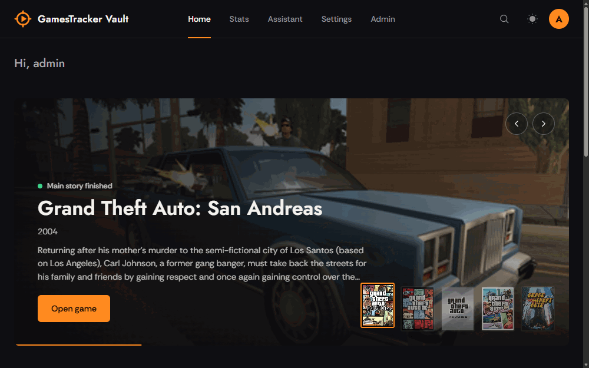
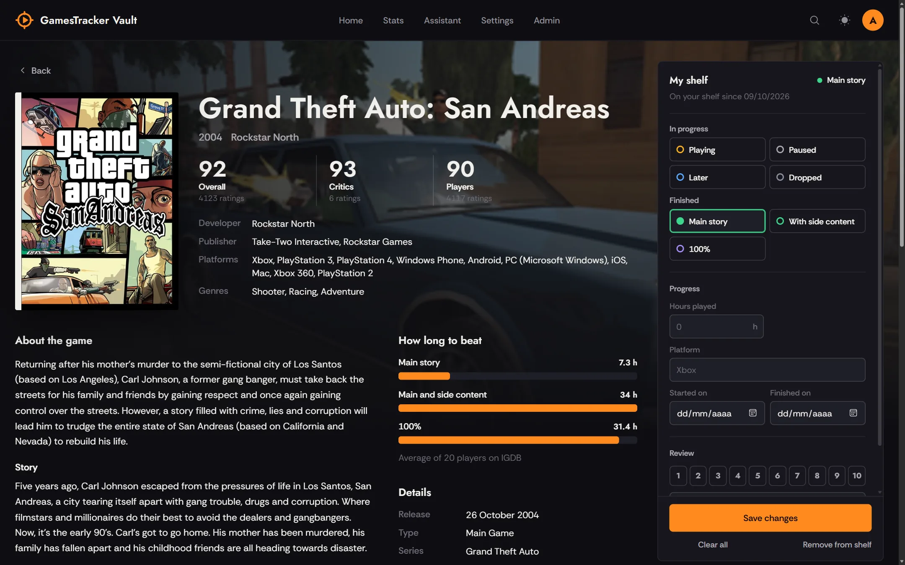
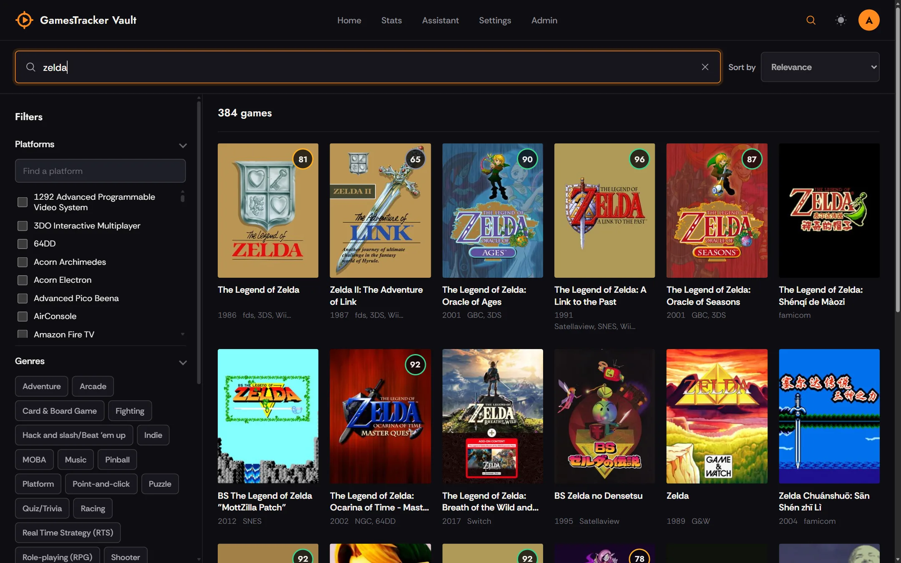
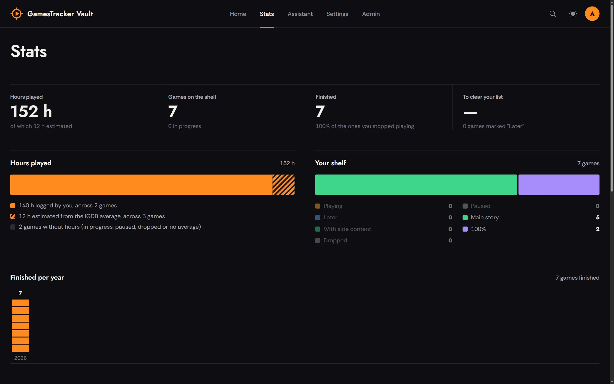
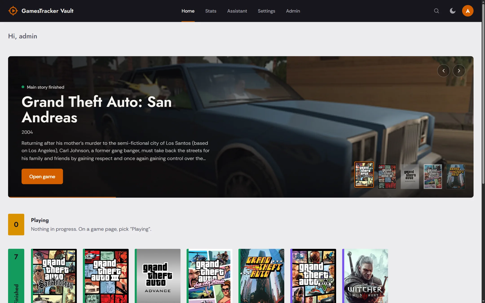
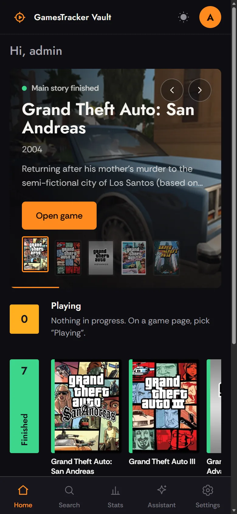
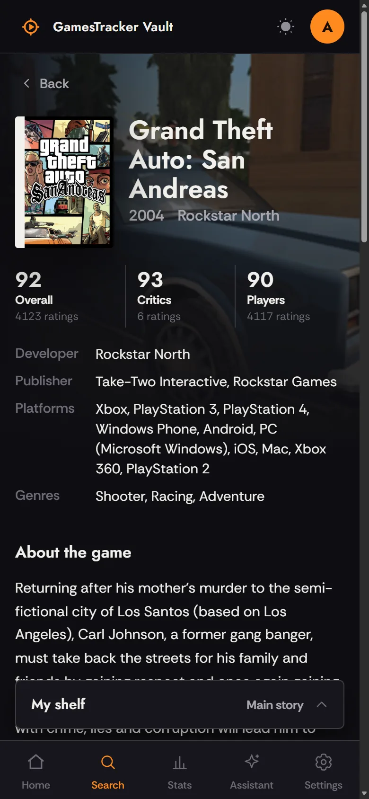
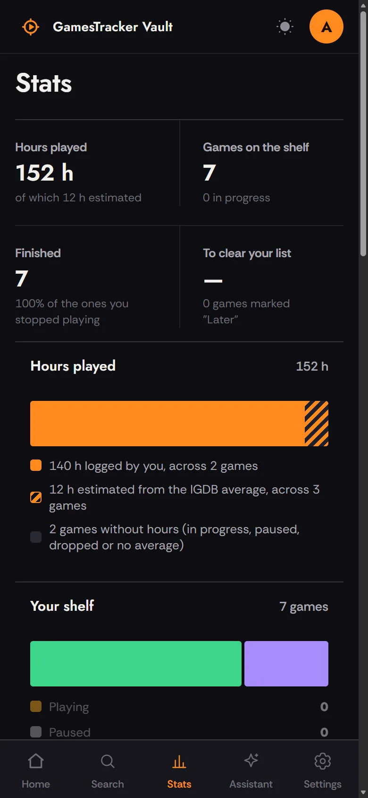
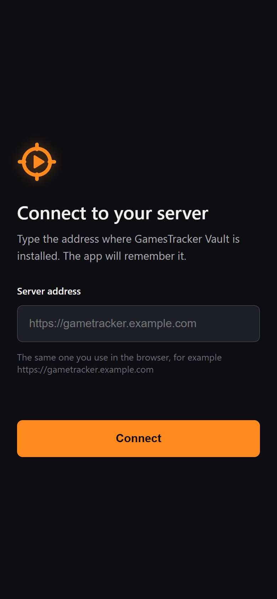

<div align="center">

# GamesTracker Vault

**A tua estante de jogos, no teu servidor.**
O que estás a jogar, o que acabaste, o que largaste e o que vem a seguir — com horas,
datas, notas, a plataforma onde jogaste e estatísticas, para toda a gente lá de casa.

[](https://github.com/TTiagoSousa/GamesTracker-Vault/releases)
[](https://github.com/TTiagoSousa/GamesTracker-Vault/actions/workflows/ci.yml)
[](./LICENSE)
[](https://github.com/TTiagoSousa/GamesTracker-Vault/pkgs/container/gamestracker-vault)

*[English](./README.md)*



</div>

## Funcionalidades

- **Pesquisa em todo o catálogo IGDB**, com filtros (plataformas, géneros, temas, modos,
  perspetivas, anos, nota mínima), e uma página para cada jogo: arte, resumo, imagens,
  vídeos e tempo médio para acabar.
- **Uma estante por pessoa**: a jogar, em pausa, para jogar, acabado (história ou com
  extras), 100% e largado, com horas, datas de início e fim, nota, apontamentos e a
  plataforma onde jogaste.
- **Um Início que mostra os teus jogos**: um destaque rotativo com o que estás a jogar,
  prateleiras que andam com setas e um jogo ao calhas quando não te decides.
- **Estatísticas**: horas, jogos por estado, género, ano e plataforma, e as tuas notas —
  com os tempos médios do IGDB onde não registaste horas.
- **Assistente** (opcional): pergunta sobre jogos e recebe recomendações com base na tua
  estante. Cada pessoa usa a sua chave da Anthropic.
- **App Android** ligada ao teu servidor, que se atualiza sozinha.
- **Vários utilizadores**, criados pelo administrador; português, inglês e espanhol; tema
  de noite e de dia; feito também para o telemóvel.
- **Backups** à hora que escolheres, para qualquer pasta, com download pelo browser.
- **Uma API REST** com tokens pessoais (acesso total ou só leitura): [docs/API.md](./docs/API.md).
- **Atualizações pela app** (Proxmox) ou com `docker compose pull`.

## Capturas de ecrã

<table>
  <tr>
    <td width="50%"></td>
    <td width="50%"></td>
  </tr>
  <tr>
    <td align="center">Página do jogo</td>
    <td align="center">Pesquisa</td>
  </tr>
  <tr>
    <td></td>
    <td></td>
  </tr>
  <tr>
    <td align="center">Estatísticas</td>
    <td align="center">Tema de dia</td>
  </tr>
</table>

<table>
  <tr>
    <td width="25%"></td>
    <td width="25%"></td>
    <td width="25%"></td>
    <td width="25%"></td>
  </tr>
  <tr>
    <td align="center">Início</td>
    <td align="center">Página do jogo</td>
    <td align="center">Estatísticas</td>
    <td align="center">App Android</td>
  </tr>
</table>

## Começar

### Docker

```bash
curl -fsSL https://raw.githubusercontent.com/TTiagoSousa/GamesTracker-Vault/main/deploy/docker/install.sh | bash
```

Cria a pasta `./gamestracker-vault` com o ficheiro compose e um `.env` com segredos
aleatórios, arranca a app e a base de dados e mostra o endereço e o login de admin.
Se preferires fazer à mão:

```bash
mkdir gamestracker-vault && cd gamestracker-vault
curl -fsSLO https://raw.githubusercontent.com/TTiagoSousa/GamesTracker-Vault/main/deploy/docker/docker-compose.yml
curl -fsSL https://raw.githubusercontent.com/TTiagoSousa/GamesTracker-Vault/main/deploy/docker/.env.example -o .env
nano .env                  # preenche os três segredos e a password do admin
docker compose up -d       # depois abre http://<máquina>:8080
```

Imagens para amd64 e arm64. Detalhes (em inglês): [docs/install-docker.md](./docs/install-docker.md).

### Proxmox VE

Na shell do anfitrião Proxmox:

```bash
bash -c "$(curl -fsSL https://raw.githubusercontent.com/TTiagoSousa/GamesTracker-Vault/main/deploy/proxmox/ct-create.sh)"
```

Cria um container Debian 13 com PostgreSQL, Node e nginx e instala a versão mais recente
(login `admin` / `admin` — muda-o). Detalhes, Debian sem Proxmox e manutenção:
[docs/install-proxmox.md](./docs/install-proxmox.md).

Já tens um container do repositório antigo (`gametrackervault`)? Muda-o com um comando:
[docs/updating.md](./docs/updating.md#moving-from-the-old-repository).

### Primeiros passos

1. Entra e muda a password: **Definições → Conta**.
2. Liga o catálogo de jogos: cria uma aplicação gratuita na
   [consola de programadores da Twitch](https://dev.twitch.tv/console/apps) (tipo
   *Confidential*; o IGDB usa contas Twitch) e põe o Client ID e o Secret em
   **Admin → Catálogo de jogos (IGDB)**.
3. Cria contas para o resto da casa em **Admin → Utilizadores**.
4. Opcional: um domínio com HTTPS ([docs/reverse-proxy.md](./docs/reverse-proxy.md)) e o
   assistente (cada pessoa põe uma chave da [Anthropic](https://console.anthropic.com/) em
   **Definições → Assistente**).

A página **Ajuda** da app explica cada passo.

## App Android

Descarrega a APK do teu servidor (**Ajuda → App Android**) ou da
[última versão](https://github.com/TTiagoSousa/GamesTracker-Vault/releases/latest),
instala-a e escreve o endereço do teu servidor. Android 8 ou mais recente. HTTPS,
certificados próprios e atualizações: [docs/android.md](./docs/android.md).

## Configuração, atualizações e backups

| | |
|---|---|
| Todas as definições | [docs/configuration.md](./docs/configuration.md) |
| Atualizar | Docker: `docker compose pull && docker compose up -d` · Proxmox: **Admin → Versões** ou `gametracker-update` · [docs/updating.md](./docs/updating.md) |
| Backup e reposição | **Admin → Backups**, e [docs/backup-restore.md](./docs/backup-restore.md) |
| Problemas | [docs/troubleshooting.md](./docs/troubleshooting.md) |
| Toda a documentação | [docs/](./docs/README.md) |

Guarda uma cópia da `TOKEN_ENCRYPTION_KEY` (no `.env`, ou em
`/root/gametracker-credentials.txt` no Proxmox): é ela que decifra as chaves guardadas na
base de dados.

## Perguntas frequentes

**Precisa de internet?** Para pesquisar e ver os detalhes dos jogos (IGDB) e para o
assistente, sim. A tua estante, as estatísticas e tudo o que escreves ficam na tua base de
dados.

**O que sai do meu servidor?** Os pedidos ao IGDB (feitos pelo servidor), as capas e os
vídeos (carregados pelo browser a partir do IGDB e do YouTube), as mensagens do
assistente de quem o configurar (enviadas à Anthropic com a chave dessa pessoa, incluindo
a estante dela) e — no Docker — a consulta da lista de versões no GitHub. Mais nada, e sem
analytics.

**Custa alguma coisa?** Não. A chave do IGDB é gratuita. O assistente usa a conta Anthropic
de cada pessoa, cobrada pela Anthropic.

**Posso importar os meus jogos de outro tracker?** Ainda não — está no roadmap.

**Há app para iPhone?** Não, mas a app web funciona no Safari e pode ser adicionada ao ecrã
principal.

**Posso instalar sem Docker nem Proxmox?** Sim: o instalador do Proxmox também funciona
numa máquina Debian 13 normal ([docs/install-proxmox.md](./docs/install-proxmox.md#without-proxmox-debian-13-vm-or-server)).

## Roadmap

Ideias em cima da mesa, não promessas:

- importar de CSV e de outros trackers;
- a app Android no F-Droid (a build `fdroid` já existe);
- listas e coleções para além dos estados;
- mais gráficos nas estatísticas (por mês, por plataforma ao longo do tempo).

Sugestões são bem-vindas nas [issues](https://github.com/TTiagoSousa/GamesTracker-Vault/issues).

## Desenvolvimento

```bash
npm install
cp apps/backend/.env.example apps/backend/.env   # preenche-o
npm run dev                                      # http://localhost:5190
```

Node 22+ e PostgreSQL. Servidor em NestJS + Prisma, app web em React + Vite, app Android
em Java. Preparação, comandos, convenções e o processo de release:
[CONTRIBUTING.md](./CONTRIBUTING.md).

| Pasta | O quê |
|---|---|
| `apps/backend` | servidor: NestJS + Prisma + PostgreSQL |
| `apps/frontend` | app web: React + Vite |
| `apps/android` | app Android (uma WebView ligada ao teu servidor) |
| `packages/shared` | tipos e constantes usados pelos dois |
| `deploy/docker` | ficheiro compose, script de instalação, entrypoint da imagem |
| `deploy/proxmox` | instalador LXC, atualizador e comandos de manutenção |
| `releases` | as notas de cada versão (en, pt-PT, es), mostradas na app |
| `docs` | guias, referência da API e documentação técnica |

## Contribuir e segurança

Contribuições são bem-vindas: lê o [CONTRIBUTING.md](./CONTRIBUTING.md) e o
[código de conduta](./CODE_OF_CONDUCT.md). Encontraste um problema de segurança? Reporta-o
em privado, como explicado no [SECURITY.md](./SECURITY.md).

## Licença

[GNU AGPL-3.0](./LICENSE). Podes usar, estudar, alterar e partilhar, também para fins
comerciais. Se puseres uma versão alterada a funcionar como serviço para outras pessoas,
tens de lhes dar o código-fonte dela, com a mesma licença.

## Apoiar

O GamesTracker Vault é gratuito e feito nos meus tempos livres. Se te é útil:

<a href="https://paypal.me/TTiagoSousa"></a>
