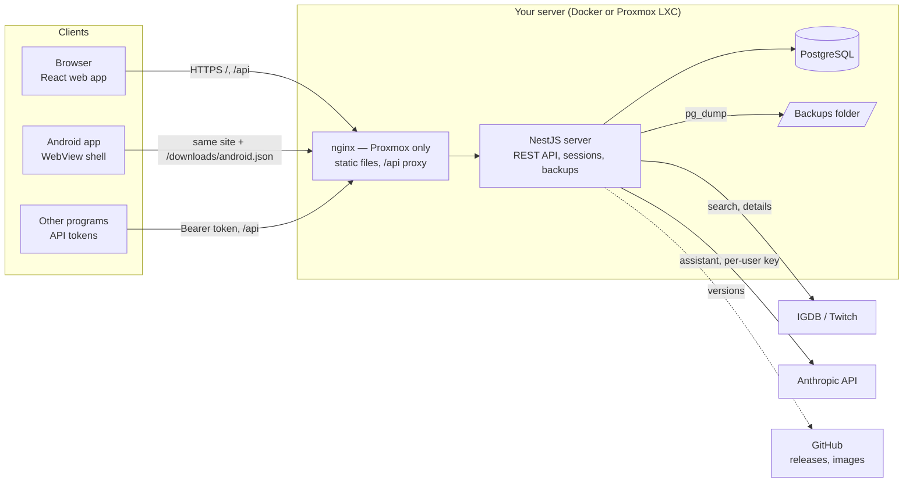

# Architecture

GamesTracker Vault is one server (NestJS + Prisma) with a PostgreSQL database, a web app
(React) that the browser loads from the same address, and an Android app that shows that
web app in a WebView. Game data comes from IGDB; the optional assistant talks to
Anthropic's API with each user's own key.

In Docker there is no nginx: the server itself serves the web app (`WEB_DIR`) and the API
under `/api`. On Proxmox, nginx serves the files and forwards `/api/*` to the server on
`127.0.0.1:3000`. Either way, the browser sees one origin: the web app at `/`, the API at
`/api`, the Android APK at `/downloads/`.

## Pieces

| Piece | Where | Notes |
|---|---|---|
| Server | `apps/backend` | NestJS 11, Prisma 7 (`@prisma/adapter-pg`), class-validator. Controller → service → helper (one function per file) → repository. |
| Web app | `apps/frontend` | React 19, Vite, SCSS, i18next (pt-PT, en, es). |
| Shared types | `packages/shared` | Roles and types used by both, built to CJS and ESM. |
| Android | `apps/android` | Java, one Activity with a WebView, no external libraries. |
| Installs | `deploy/docker`, `deploy/proxmox` | Docker image and compose; LXC installer, updater and maintenance commands. |

## Authentication

- **Browser:** username and password → an httpOnly session cookie (JWT). It is `secure`
  when the request came over HTTPS, as reported by a trusted proxy (`TRUST_PROXY`).
- **API tokens:** `Authorization: Bearer gtv_…`, created per user in Settings, full access
  or read-only. Only a hash is stored. Some actions (tokens themselves, password changes)
  need a real session.
- **Roles:** `ADMIN` and `USER`. The first account is the admin; after that registration
  is closed and admins create accounts.

## Data

PostgreSQL, with migrations in `apps/backend/prisma/migrations` applied on every start or
update. Main tables: `User`, `LibraryEntry` (a game on a user's shelf: status, hours,
dates, rating, notes, platform), `Game` (cached IGDB facts), `Integration` (IGDB
credentials, encrypted), `AiSettings` (per-user assistant key, encrypted), `ApiToken`,
`BackupSettings`. Details in [development/03-data-model.md](./development/03-data-model.md).

Secrets stored in the database are encrypted with AES-256-GCM using
`TOKEN_ENCRYPTION_KEY`.

## Versions and updates

The version is a git tag (`vX.Y.Z`) shared by the server, the web app and the Android
app.

- **Proxmox:** the install is a git checkout. The server reads its version and the
  available releases from git; **Update** in the app writes a request file that a root
  systemd unit picks up and runs `update.sh` (fetch, build, migrate, restart, roll back on
  failure).
- **Docker:** the image carries its version (`APP_VERSION`); the server compares it with
  the GitHub releases. Updating is `docker compose pull`.
- **Android:** each server serves the APK of its release and `android.json`; the app
  installs a newer one when it sees it.

## Outside connections

Only these leave your server: IGDB (search and details, by the server), images and
videos from IGDB and YouTube (loaded by the browser), Anthropic (assistant messages, only
for users who set a key), and GitHub (release list, Docker installs only).

More depth for developers: [development/02-architecture.md](./development/02-architecture.md).
